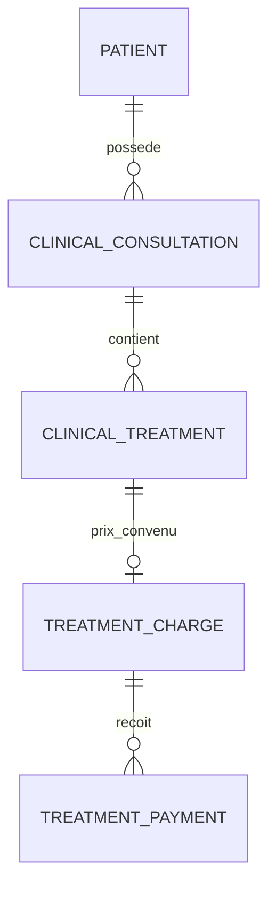

# Prix des soins, encaissements et solde patient — 8.6A.1

## Périmètre livré

Cette phase ajoute V9, un registre financier PostgreSQL et un service transactionnel interne. Aucun contrôleur REST, écran, facture ou PDF n’est ajouté. Le [prototype de facturation](billing-management.md) reste distinct et inchangé.

Le travail facturable provient d’un soin clinique enregistré, jamais d’une ordonnance. Le parcours approuvé reste : accueil administratif du patient, consultation du dentiste, saisie du soin et de son prix convenu, encaissements par le dentiste ou l’accueil, puis lecture des soldes. Une future facture devra référencer la charge existante ; elle ne créera pas une seconde dette pour ce même soin.

Le dossier officiel est `docs/references/pdf-templates/dossier-patient.pdf`. Son verso a été extrait et rendu en lecture seule : **DATE | TRAITEMENT | PRIX | REÇU | RESTE**. Ce document, les modèles, polices et éléments de marque ne changent pas.

## Modèle retenu



| Table | Données |
| --- | --- |
| `treatment_charge` | UUID serveur, patient, consultation, soin, date et libellé du soin conservés, prix en centimes, devise MAD, version, création/modification et acteur créateur |
| `treatment_payment` | UUID serveur, charge unique d’allocation, clé UUID d’opération, montant en centimes, instant de paiement, mode, instant et acteur d’enregistrement |
| `security_audit_event` existant | Nouvelles cibles charge/paiement et deux catégories d’événements, sans payload libre |

Une charge est permanente dans ce périmètre. L’unicité porte sur le soin pendant toute sa durée de conservation ; elle est plus restrictive qu’une unicité partielle de charges actives, puisqu’aucune annulation ou charge de remplacement n’est approuvée. Il n’existe pas de statut d’annulation implicite. Les états `DUE`, `PARTIAL` et `SETTLED` sont des projections calculées des montants, pas des colonnes modifiables.

Les FK composites imposent `(consultation, patient)` et `(soin, consultation)`. Les clés étrangères financières ont `ON DELETE RESTRICT`, sans cascade. Aucun solde, montant reçu ou reste indépendant n’est ajouté au patient ou à la charge.

## Argent et invariants

Tous les prix et paiements sont des entiers `bigint` de centimes MAD : 300 DH correspond à `30000`. Les montants unitaires sont compris entre 0 et `9007199254740991` pour un prix et entre 1 et cette même borne pour un paiement. Zéro est un prix explicite, jamais une valeur substituée à un prix absent. Une charge à zéro est soldée sans paiement fictif.

Le service accepte des `Long`, jamais des nombres à virgule flottante. Il ne convertit ni n’arrondit une saisie décimale. La future frontière REST devra refuser fractions, coercitions, dépassements et montants absents ; le frontend devra effectuer une conversion exacte depuis la saisie en dirhams.

Les sommes PostgreSQL utilisent `numeric` issu de `sum(bigint)`. Les totaux patient deviennent des `BigInteger` Java : ils restent exacts même lorsque plusieurs montants unitaires sûrs dépassent ensemble la limite des entiers JavaScript. Les futures réponses REST devront représenter ces totaux par des chaînes décimales entières ; sérialiser aveuglément ces `BigInteger` en nombres JSON serait incompatible avec un client JavaScript exact.

Pour chaque charge :

- `reçu = somme des paiements de cette charge` ;
- `reste = prix − reçu`, toujours positif ou nul ;
- un paiement contribue à une seule charge, sans transfert ou répartition automatique ;
- un paiement est strictement positif et ne peut dépasser le reste ;
- les paiements, leur charge, leurs montants, dates, modes et acteurs sont immuables.

Le total patient additionne les charges enregistrées, leurs paiements et leurs restes. Il inclut les charges de consultations encore en brouillon : le prix a été explicitement convenu. Un soin sans prix n’est pas une charge à zéro et n’entre pas dans ces totaux. Le futur écran devra signaler ces soins non tarifés au dentiste plutôt que leur attribuer un défaut ou présenter un total comme comprenant du travail non tarifé.

## Prix et cycle clinique

L’[agrégat clinique existant](clinical-service-contract.md) possède une version parent. Chaque ajout, édition ou retrait de soin et la clôture verrouillent le patient puis la consultation. Une consultation `TERMINEE` est en lecture seule au service ; ses règles de finalisation ne sont pas réécrites.

`createCharge` exige un patient actif, un soin actif du même patient/consultation, une consultation `BROUILLON`, sa version attendue et un prix explicite. Il prend le même verrou de consultation que les mutations cliniques, vérifie la version puis crée un agrégat financier distinct. Il ne change ni version, ni timestamp, ni contenu clinique. La version de charge, initialement zéro, représente ensuite le nombre de paiements enregistrés.

Décision conservatrice de cette phase : **le prix convenu est attribué une seule fois**. Aucun service de modification de prix n’est exposé, même avant paiement. Cela évite d’inventer un mécanisme de correction non approuvé. Les prix sont donc protégés avant et après le premier paiement et après clôture clinique. Il n’y a pas d’événement de changement de prix dans une API qui n’autorise aucun tel changement.

La charge conserve la date et le libellé du soin au moment de son attribution. Une garde V9 interdit ensuite la suppression, le retrait, le changement de date, de libellé ou d’association de ce soin. Les notes et la référence dentaire restent modifiables par le dentiste tant que les règles cliniques existantes l’autorisent ; elles n’entrent pas dans la charge. Les soins non tarifés conservent leur cycle antérieur. Cette restriction empêche de retirer silencieusement du travail dont le compte financier doit être conservé.

Une correction de prix, un retrait de soin déjà tarifé, un remboursement, une annulation ou une contrepassation nécessitent un contrat métier approuvé avec conservation explicite de l’historique. Aucun de ces workflows n’est implémenté. Les gardes de base refusent les écritures incompatibles ; elles ne compensent pas un paiement et ne suppriment pas une charge.

Les encaissements sont permis avant ou après clôture de la consultation. Ils ne changent jamais le contenu clinique finalisé. Les patients archivés restent lisibles ; toute écriture financière est refusée, y compris le rejeu d’une clé connue. Aucune exception à la politique d’archivage ni restauration automatique n’est introduite.

## Contrat de service interne

`TreatmentFinancialService` retourne uniquement des records détachés dans `FinancialModels`. `FinancialRepository` reste interne au package et utilise des requêtes paramétrées, dans la même transaction Spring que l’audit JPA existant.

| Méthode | Contrat |
| --- | --- |
| `createCharge(patient, consultation, soin, expectedConsultationVersion, priceMinor)` | Dentiste ; attribution unique pendant un brouillon actif ; retourne une ligne financière |
| `recordPayment(patient, charge, expectedChargeVersion, PaymentInput)` | Dentiste ou accueil ; encaissement atomique contre une seule charge |
| `getCharge(patient, charge)` | Ligne financière de cette charge, avec reçu/reste calculés |
| `summary(patient, after)` | Au plus 50 lignes financières, curseur suivant et totaux complets du patient |
| `payments(patient, charge, after)` | Au plus 50 paiements de cette charge et curseur suivant |

Les refus sont typés : `INVALID_INPUT`, `NOT_FOUND` pour une absence ou un mauvais périmètre, `ARCHIVED_PATIENT`, `INELIGIBLE_TREATMENT`, `CONSULTATION_FINALIZED`, `DUPLICATE_CHARGE`, `VERSION_CONFLICT`, `OVERPAYMENT`, `OPERATION_CONFLICT` et `STORAGE_FAILURE` pour une écriture non confirmée. Les refus de rôle/session gardent les exceptions Spring Security existantes.

`PaymentInput` contient montant, `paidAt`, mode et clé UUID `operationId`. Les modes reprennent ceux du projet : `ESPECES`, `CARTE`, `VIREMENT`, `CHEQUE`, `AUTRE`. Il s’agit d’un classement d’encaissement, pas d’un appel à un prestataire de paiement. Aucun numéro de carte, texte clinique libre ou note de paiement n’est ajouté.

`paidAt` est l’instant explicitement fourni, UTC, de l’an 1 à 9999, avec précision maximale à la microseconde. Aucune date de consultation n’est substituée et aucune règle non approuvée de rapprochement des dates n’est inventée. `recordedAt` est choisi par le serveur à la microseconde, strictement après la dernière modification de la charge. L’UUID d’acteur provient du principal authentifié, jamais de la commande.

## Autorisation et confidentialité

Le service utilise les politiques existantes `RolePolicies.CLINICAL` pour créer un prix et `RolePolicies.ADMINISTRATIVE` pour lire/encaisser. Il vérifie aussi un `AccountPrincipal`, l’activité du compte, son rôle courant et sa version de session. Les écritures verrouillent en partage le compte pour coordonner désactivation/révocation et commit. La projection de compte est lue directement, sans se fier à une entité JPA qui pourrait être ancienne dans une transaction englobante.

L’accueil ne peut ni créer un soin ni attribuer un prix. La projection `Row` expose seulement : identifiant de charge, version, date, libellé du traitement, devise, prix, reçu, reste et état de règlement. Les paiements exposent leurs seules métadonnées de collecte et identifiants. Aucun DTO clinique, note, diagnostic d’évaluation, allergie, questionnaire ou ordonnance n’est chargé dans ces projections. Le libellé est la désignation du soin, pas ses notes ; le dentiste doit conserver cette désignation adaptée à l’usage de collecte.

Les commandes/résultats financiers masquent leur contenu dans `toString`. Les échecs de domaine n’incluent ni SQL, ni cause technique, ni contenu rejeté. Aucun log métier de payload n’est ajouté. Les dépôts ne sont pas une frontière d’autorisation et ne doivent pas être injectés dans un futur contrôleur pour contourner le service.

## Transactions, concurrence et rejeu

Ordre des verrous d’écriture : compte en partage, patient en partage, consultation, puis charge. L’attribution d’un prix prend la consultation en écriture et le soin en partage. Un paiement prend la consultation en partage, puis la charge en écriture. L’archivage patient et la clôture clinique utilisent les mêmes parents ; leur ordre est conservé.

Une transaction de paiement en `READ_COMMITTED` :

1. Valide les types, bornes, périmètre patient/charge et activité du patient.
2. Verrouille les parents, puis la charge par `FOR UPDATE`.
3. Cherche la clé d’opération dans cette charge. Un contenu identique retourne le paiement existant et l’état courant de la charge, sans nouvelle écriture ni audit ; un montant, instant ou mode différent donne `OPERATION_CONFLICT`.
4. Pour une nouvelle opération, vérifie la version attendue puis le reste calculé sous verrou.
5. Insère le paiement. La garde PostgreSQL vérifie de nouveau la capacité, avance la version et le timestamp de charge, puis l’audit est écrit et flushé dans la même transaction.
6. Au commit, des contraintes différées vérifient `version de charge = nombre de paiements` et `somme des paiements <= prix`.

Deux collecteurs qui soumettent la même ancienne version ne peuvent tous deux créer une nouvelle écriture : le second retrouve une nouvelle version et reçoit `VERSION_CONFLICT`. Deux appels identiques avec la même clé retrouvent le même UUID de paiement. Aucun retry automatique ni transfert entre traitements. En cas de réponse perdue, relire ou soumettre explicitement la même clé et le même contenu ; une nouvelle collecte doit utiliser une nouvelle clé et une version relue.

Les gardes SQL interdisent aussi mise à jour/suppression d’un paiement, destruction ou modification du prix/source d’une charge et surpaiement via une insertion SQL directe. La version seule ne peut être avancée sans paiement correspondant. Ces protections concernent le rôle applicatif ordinaire ; elles ne prétendent pas résister à un superutilisateur qui désactive les triggers.

L’audit et les mutations partagent le gestionnaire transactionnel existant : un échec d’audit annule charge/paiement et version ; un échec d’une transaction englobante annule aussi les écritures cliniques qu’elle a effectuées. Une composition future doit utiliser une transaction d’écriture compatible, pas une transaction clinique de lecture seule.

## Historique, totaux et verso

Les lignes sont triées par `(date du soin, UUID de charge)` croissants. Les paiements sont triés par `(paidAt, UUID)` croissants. Les curseurs sont exclusifs, les pages ont une borne fixe de 50, et une page pleine peut être suivie d’une page vide. Il n’existe ni lecture globale, ni taille de page arbitraire, ni accumulation automatique.

Chaque ligne charge/prix/reçu/reste est calculée par jointure/agrégation, sans un appel de dépôt par ligne. Les totaux patient agrègent toutes ses charges et paiements, indépendamment de la page. `summary` s’exécute en `REPEATABLE_READ` afin que ses lignes et ses totaux correspondent au même snapshot. Les pages successives restent des transactions distinctes ; elles ne promettent pas un snapshot commun en présence de nouveaux soins tarifés.

La projection du verso est directement : `date | treatmentLabel | priceMinor | receivedMinor | remainingMinor`. La conversion en DH et la mise en page du dossier restent futures. Le scénario synthétique de référence est vérifié : prix 300/500/400 DH, reçus 200/500/0 DH, restes 100/0/400 DH ; total 1 200 DH, reçu 700 DH, reste 500 DH.

## Audit et migration

V9 ajoute `target_charge_id` et `target_payment_id` au journal existant, avec références restrictives, cohérence paiement/charge et index. Les catégories nouvelles sont `TREATMENT_CHARGE_CREATED` et `TREATMENT_PAYMENT_RECORDED`. Elles exigent acteur et cibles appropriées, avec toutes les cibles cliniques/administratives non pertinentes nulles. Le journal conserve UUID, type et instant ; il ne copie ni libellé, ni notes, ni montant dans un payload.

La migration ne réécrit aucun soin, facture, ordonnance ou solde. Elle ajoute les deux tables, clés uniques/composites, contraintes, index et gardes, et étend les contraintes du journal. V1–V8 restent inchangées. Aucun compte, prix, paiement ou charge de départ n’est injecté. Le test de montée V8→V9 conserve checksums, données cliniques et octets d’un document synthétique finalisé déjà enregistré.

## Intégration restante, hors de cette phase

- Définir les DTO REST stricts, les statuts HTTP/Problem Details et l’allowlist d’authentification/proxy, sans exposer le dépôt ou des entités JPA. Les erreurs du service restent typées mais n’ont pas encore de mapping HTTP dédié.
- Composer la saisie clinique du prix avec l’ajout du soin dans un service applicatif transactionnel : appeler `ConsultationService.addTreatment`, récupérer l’UUID réel et la version renvoyée, puis `createCharge` dans la même transaction. En cas d’attribution ultérieure, relire la consultation et fournir sa version. Aucun prix n’est ajouté au DTO clinique existant dans cette phase.
- Présenter la décision d’attribution définitive avant l’appel. Si le cabinet souhaite modifier ensuite un prix ou retirer un soin tarifé, approuver d’abord un mécanisme de correction explicite ; ne pas contourner les gardes V9.
- Traduire les refus des gardes de soin tarifé dans le futur parcours clinique, avant de rendre des charges créables depuis l’interface. Le service clinique actuel n’est pas réécrit pour mapper ces erreurs SQL.
- Construire l’écran d’encaissement de l’accueil à partir des projections financières, sans requête de notes cliniques ; conserver la clé d’opération pour résoudre une réponse perdue sans doubler une collecte.
- Transporter les totaux exacts comme chaînes entières et définir leur affichage MAD. Brancher le verso et la facture future sur les mêmes charges, avec protections spécifiques de duplication de facturation à définir lors de cette phase future.

Aucun de ces travaux REST/frontend/facturation n’est commencé ici. Aucun remboursement, annulation, transfert, correction de prix ou contrepassation n’est supposé disponible.

## Fichiers concernés

- `backend/src/main/resources/db/migration/V9__treatment_financial_ledger.sql` : tables, relations, index, gardes et cibles d’audit.
- `backend/src/main/java/ma/sijilmassa/finance/{FinancialModels,FinancialFailure,FinancialRepository,TreatmentFinancialService}.java` : projections, refus typés, requêtes et service.
- `backend/src/main/java/ma/sijilmassa/audit/{AuditEventType,SecurityAudit,SecurityAuditEvent}.java` : extension du journal existant.
- `backend/src/test/java/ma/sijilmassa/TreatmentFinancialMigrationTest.java` et `backend/src/test/java/ma/sijilmassa/finance/TreatmentFinancialServiceTest.java` : migration, invariants, accès, exactitude, concurrence et rollback.
- Tests existants adaptés à V9 : `AppointmentIntegrationTest`, `AuthenticationIntegrationTest`, `PatientIntegrationTest`, `PostgresFoundationTest`, `clinical/ConsultationServiceTest` et `BrowserIntegrationEnvironment`, tous sous `backend/src/test/java/ma/sijilmassa/`. Les nettoyages concernent exclusivement les bases jetables. Le launcher navigateur déjà modifié par 8.5C.3B est conservé, avec sa seule attente de migration avancée à V9.
- `docs/treatment-financial-ledger-contract.md` : décisions, résultats et limites.

Le harnais frontend navigateur attend encore V1–V8. Il devra être aligné sur V1–V9 lors du prochain lot qui autorise cette modification. Aucun test frontend ou navigateur n’est exécuté ici.

## Validation exécutée le 11 novembre 2026

Exécutions depuis `backend/` sur PostgreSQL **17.11** Testcontainers, avec un socket Podman privé et `TESTCONTAINERS_RYUK_DISABLED=true`. Le runtime est **JDK 25.0.4.1**, compilation `--release 21` ; aucun test n’est revendiqué sur un JDK 21 installé. Les régressions de rendu utilisent le worker existant avec Node **24.20.0**. Aucun `.env` du cabinet ni enregistrement réel n’est utilisé.

```sh
./mvnw -B -ntp -Dtest=TreatmentFinancialServiceTest,TreatmentFinancialMigrationTest test
./mvnw -B -ntp -Dtest=ConsultationServiceTest,ClinicalHttpIntegrationTest,PrescriptionHttpIntegrationTest,PrescriptionFinalizationIntegrationTest,AppointmentIntegrationTest,PatientIntegrationTest,AuthenticationIntegrationTest,PostgresFoundationTest test
./mvnw -B -ntp -Dtest=ConsultationServiceTest test
./mvnw -B -ntp verify
```

| Vérification | Résultat |
| --- | --- |
| Service financier et migration V8→V9 | **40/40**, dont 35 tests service et 5 migration/contraintes ; 0 échec, erreur ou ignoré |
| Régressions ciblées | **169 contrôles distincts réussis** après correction de l’attente du schéma d’audit : 25 service clinique, 25 HTTP clinique, 24 HTTP prescriptions, 27 finalisation, 26 rendez-vous, 25 patients, 14 authentification et 3 fondation PostgreSQL |
| `./mvnw -B -ntp verify` | **271/271**, 0 échec, 0 erreur, 0 ignoré, en un passage complet de 3 min 57 s |
| JAR de production | Construit et reconditionné avec succès : `backend/target/sijilmassa-backend-0.1.0-SNAPSHOT.jar`. Le manifeste et la présence de V9 et du service financier dans l’archive sont vérifiés |
| Intégrité | SHA-256 de V1–V8 inchangés ; dossier patient toujours `f68cf8351f368bf2b0d52dd3c2aa0e421294442c729c114b169d4107f11e69b4` ; `git diff --check` et `git status` exécutés |

Le premier lot financier comptait 39 tests, avec deux erreurs de préparation d’espions d’audit sur un proxy transactionnel et une attente incorrecte du type d’exception Spring Security en l’absence de principal. Le harnais est corrigé ; un test de révocation avec compte JPA déjà chargé porte le lot à 40. Le premier lot de régression comptait 168 réussites et un échec : une assertion clinique énumérait les colonnes V8 du journal. La liste V9 est vérifiée en gardant l’exigence que les nouvelles cibles soient nulles pour les événements cliniques ; la reprise de la suite clinique donne 25/25. Aucun échec intermittent restant n’est observé dans le `verify` final.

L’atomicité est exercée avec des erreurs d’audit injectées et une transaction englobante annulée. Les deux rôles soumettent des paiements simultanés contre la même charge, dont un test de rejeu concurrent identique. Les tests vérifient aussi un paiement après clôture sans changement du dossier clinique, la lecture après archivage sans écriture, les pages de plus de 50 lignes, la projection sans note ni diagnostic et les totaux au-delà de la précision des entiers JavaScript.

Les tests existants de prescriptions et rendez-vous ont été exécutés dans le lot ciblé et le `verify` final. Aucune suite frontend ou navigateur n’a été relancée. Le scanner Unslop décline le français ; le contrat et les messages sont relus manuellement. Les services et conteneurs jetables sont arrêtés après vérification. Aucun commit, push, déploiement ou démarrage de 8.6A.2.
